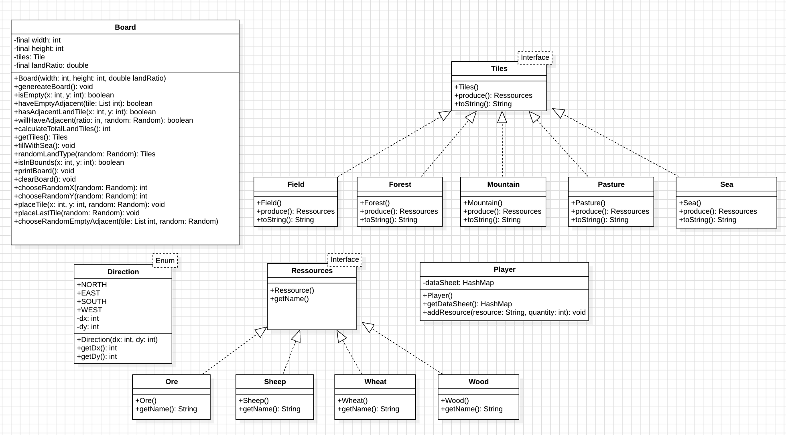
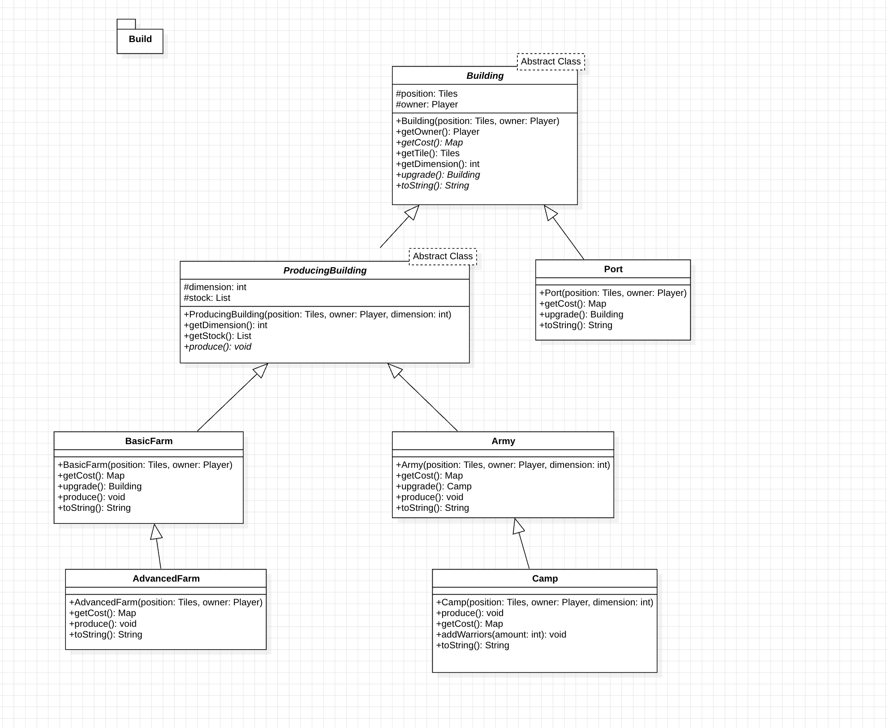
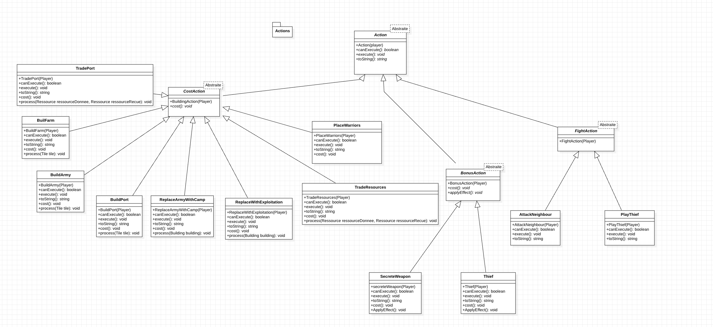
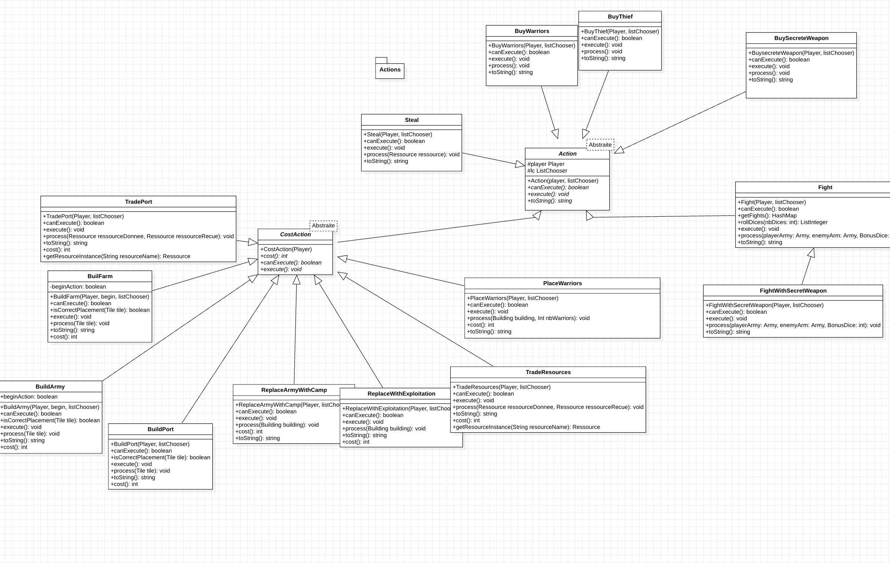
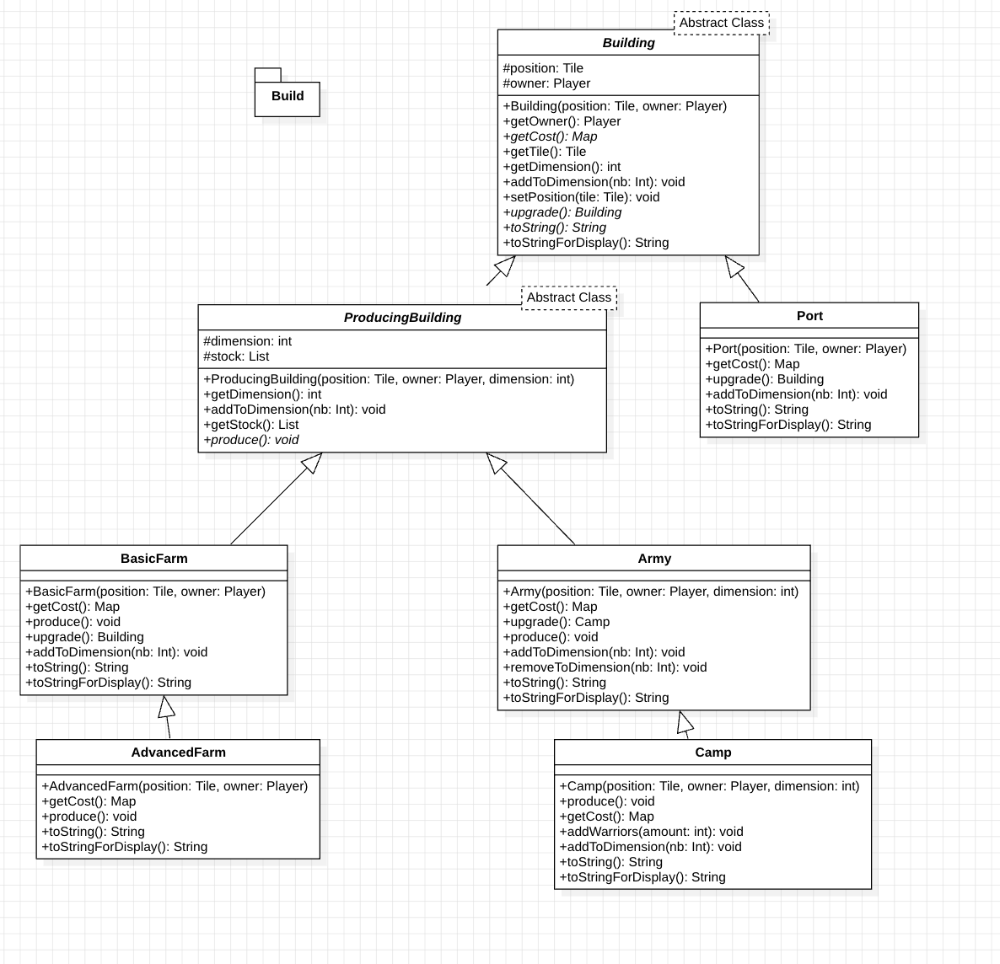
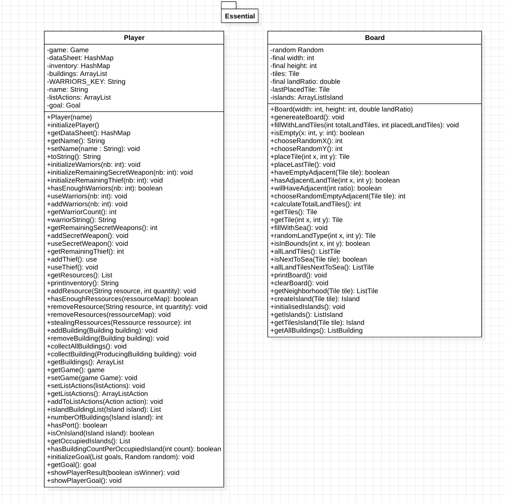
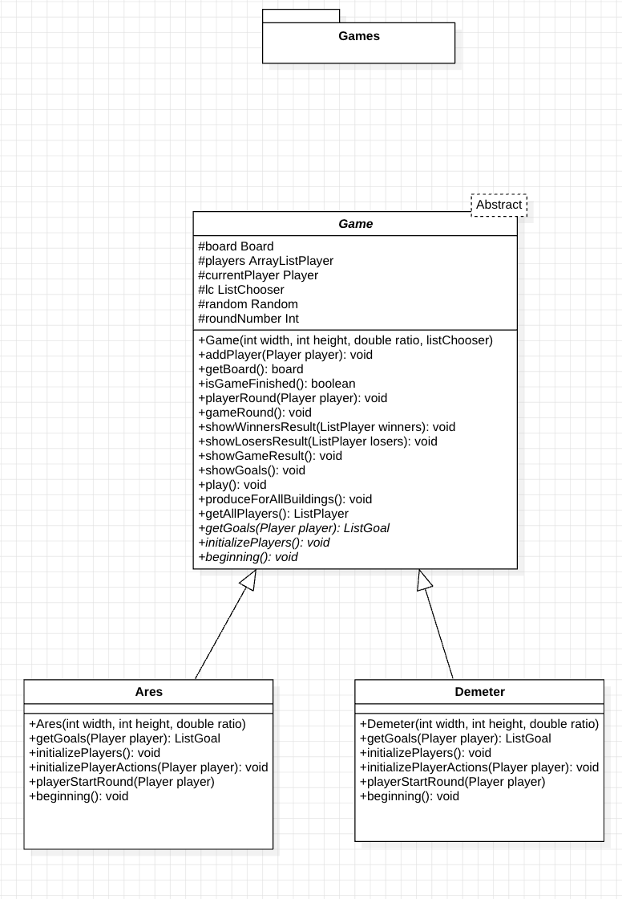
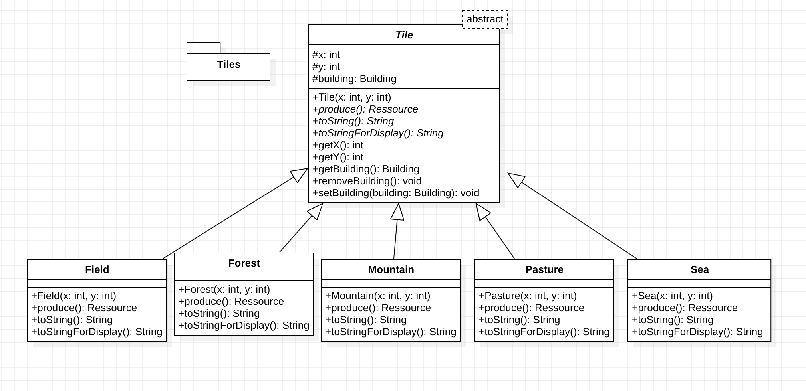

# l2s4-projet-2025


# Equipe

- Maëva OCHSENFELD
- Yanis HUSQUIN
- Enzo DEMORY
- Thaïs LAROQUE

# Sujet

[Le sujet 2025](https://www.fil.univ-lille.fr/~varre/portail/l2s4-projet/sujet2025.pdf)

# Livrables

Les paragraphes concernant les livrables doivent être rempli avant la date de rendu du livrable. A chaque fois on décrira l'état du projet par rapport aux objectifs du livrable. Il est attendu un texte de plusieurs lignes qui explique la modélisation choisie, et/ou les algorithmes choisis et/ou les modifications apportées à la modélisation du livrable précédent.

Un lien vers une image de l'UML doit être fourni (une photo d'un diagramme UML fait à la main est suffisant).

## Livrable 1

### Atteinte des objectifs

Pour le livrable 1, après 1 mois de travail sur ce projet nous avons réussi à modéliser la génération du tableau qui se fait dans une fonction generateBoard qui génère un plateau de jeu en plaçant aléatoirement des tuiles de terre tout en respectant certaines contraintes. Elle commence par initialiser une liste pour stocker les tuiles de terre et détermine le nombre total à placer. Ensuite, elle utilise une boucle pour positionner ces tuiles, en commençant par une tuile aléatoire. Si des cases adjacentes sont disponibles, elle tente d’en placer d'autres à proximité avec une probabilité donnée. Si l'ajout échoue ou qu'il n'y a plus d’espace adjacent libre, elle recommence avec une nouvelle tuile aléatoire. Une fois toutes les tuiles de terre placées, le plateau est complété avec des tuiles d'eau, puis validé.

Voici l'algoritme de génération du plateau en pseudo-code :
```
Tant que 1/3 des tuiles de terre ne sont pas placées :  
    Si la dernière tuile placée == None  
        Choisir un emplacement du tableau au hasard parmis une liste de tuple de coordonnées (x,y)  
        Placer une case à cet endroit en choisissant entre les différents type (forêts, montagnes, patûrages, champs) au hasard  
        Prend  les coordonnées de la tuile qu'on vient de poser pour les déplacer afin de les stocker dans une liste dédié aux cases terres  
    Sinon :  
        Choix aléatoire pour déterminé si la dernière tuile placée aura une tuile voisine  
        Si la dernière tuile placée possédera une tuile voisine :  
            Placer une case adjacente en choisissant la direction dans laquel la placer (Nord, Sud, Est, West)  
            La dernière tuile placée prend la valeur de cette case  
        Sinon :  
            La dernière tuile placée prend la valeur None
```

Pour représenter les tuiles et les ressources, nous avons choisi de les modéliser à l’aide d’une interface afin de faciliter l’ajout futur d’autres types de tuiles ou de ressources.

Pour vérifier notre plateau et placer les tuiles, nous avons également créé une énumération Direction définissant les quatre directions principales : Nord, Est, Ouest et Sud.

Jar exécutable : livrable1.jar

```bash
 java -jar livrable1.jar 10 8 
```

Voici notre UML pour ce livrable 1 :



### Difficultés restant à résoudre

Nous rencontrons encore une difficulté avec le plateau : la contrainte empêchant une tuile isolée, qui n’a pas lieu d’être. Nous allons tenter de résoudre ce problème au plus vite.

### Commandes

##### Comment générer la documentation ?

Nous pouvons générer la documentation de l'ensemble des classes dans un dossier docs en exécutant cette commande :  
```bash
javadoc -sourcepath src src/*/*.java -d docs
```

##### Comment compiler les classes du projet ?

Nous pouvons compiler les classes du projet en exécutant cette commande :  
```bash
javac -sourcepath src src/*/*.java -d classes
```

##### Comment tester l'exécution du programme ?

Nous pouvons tester l'exécution du programme en exécutant cette commande avec deux paramètres qui sont la largeur et la hauteur (ici, on prendra pour l'exemple une largeur de 10 et une hauteur de 8):  
```bash
java -classpath classes Essential.Livrable1 10 8
```

##### Comment créer le jar exécutable ?

Nous pouvons créer le jar exécutable en exécutant cette commande :  
```bash
jar cvfe livrable1.jar Essential.Livrable1 -C classes Essential -C classes TilesType -C classes utils
```

##### Comment exécuter le jar exécutable ?

Nous pouvons exécuter le jar exécutable en exécutant cette commande avec deux paramètres qui sont la largeur et la hauteur (ici, on prendra pour l'exemple une largeur de 10 et une hauteur de 8):  
``` bash 
java -jar livrable1.jar 10 8 
```

##### Comment compiler les classes de test du projet ?

Nous pouvons compiler les classes de test du projet en exécutant cette commande :  
```bash
javac -classpath junit-console.jar:classes test/*/*.java -d classes
```

##### Comment exécuter les tests ?

Nous pouvons exécuter les classes de test du projet en exécutant cette commande :  
```bash
java -jar junit-console.jar -classpath test:classes -scan-classpath
```


## Livrable 2

### Atteinte des objectifs

Pour le livrable 2, après 2 mois de travail sur ce projet nous avons réussi à modéliser les differents batiments.Nous avons choisis de faire une classe abstraite, avec comme classe mère Building, pour representer par la suite Army, BasicFarm,Port, ProducingBuilding, Army, AdvancedFarm. 

Voici notre UML pour ce livrable 2 :



### Commandes

##### Comment générer la documentation ?

Nous pouvons générer la documentation de l'ensemble des classes dans un dossier docs en exécutant cette commande :  
```bash
javadoc -sourcepath src src/*/*.java -d docs
```

##### Comment compiler les classes du projet ?

Nous pouvons compiler les classes du projet en exécutant cette commande :  
```bash
javac -sourcepath src src/*/*.java -d classes
```


##### Comment tester l'exécution du programme ?

Nous pouvons tester l'exécution du programme en exécutant cette commande avec deux paramètres qui sont la largeur et la hauteur (ici, on prendra pour l'exemple une largeur de 10 et une hauteur de 8):  
```bash
java -classpath classes Essential.Livrable2 10 8
```

##### Comment créer le jar exécutable ?

Nous pouvons créer le jar exécutable en exécutant cette commande :  
```bash
jar cvfe livrable2.jar Essential.Livrable2 -C classes Essential -C classes TilesType -C classes utils -C classes Buildings
```

ou

```bash
jar cvfe livrable2.jar Essential.Livrable2 -C classes ./
```

##### Comment compiler les classes de test du projet ?

Nous pouvons compiler les classes de test du projet en exécutant cette commande :  

```bash
javac -classpath junit-console.jar:classes tests/*/*.java -d classes
```


##### Comment exécuter les tests ?

Nous pouvons exécuter les classes de test du projet en exécutant cette commande :  
```bash
java -jar junit-console.jar -classpath test:classes -scan-classpath
```


## Livrable 3

### Atteinte des objectifs

Pour ce livrable 3, après 3 mois de travail nous avons réussi à modéliser les actions. Les actions jouent un rôle essentiel en définissant ce que les joueurs peuvent faire à chaque tour. Une action peut être la construction d'un bâtiments, l'échange de ressources, ou encore l'attaque d'un adversaire. Afin d'assurer une structure claire et extensible, nous avons choisi une modélisation orientée objet basée sur une classe abstraite et des classes dérivées.  

Toutes les actions partagent des comportements en communs: elles sont liées à un joueur, peuvent être exécutées sous certaines conditions et ont une représentation textuelle.

**Pourquoi utiliser une telle structure ?**


La classe Action centralise la gestion des actions et permet une extension facile.  Les différentes sous-classes comme CostAction BonusAction ou encore FightAction évite la duplication de code. De plus les classes concrète pour chaque action facilite l'ajout de nouvelles actions sans modifier le code existant, sans compter que ça nous permet d'avoir une meilleure lisibilité et un code modulaire.

Voici notre UML pour ce livrable 3:



### Commandes

##### Comment générer la documentation ?

Nous pouvons générer la documentation de l'ensemble des classes dans un dossier docs en exécutant cette commande :  
```bash
javadoc -sourcepath src src/*/*.java -d docs
```

##### Comment compiler les classes du projet ?

Nous pouvons compiler les classes du projet en exécutant cette commande :  
```bash
javac -sourcepath src src/*/*.java -d classes
```


##### Comment tester l'exécution du programme ?

Nous pouvons tester l'exécution du programme en exécutant cette commande avec deux paramètres qui sont la largeur et la hauteur (ici, on prendra pour l'exemple une largeur de 10 et une hauteur de 10):  

```bash
java -classpath classes Essential.Livrable3ares 10 10

java -classpath classes Essential.Livrable3demeter 10 10
```

##### Comment créer le jar exécutable ?

Nous pouvons créer le jar exécutable en exécutant cette commande :  

```bash
jar cvfe livrable3ares.jar Essential.Livrable3ares -C classes Actions -C classes Buildings -C classes Essential -C classes Games -C classes Ressources -C classes Tiles -C classes utils -C

jar cvfe livrable3demeter.jar Essential.Livrable3demeter -C classes Actions -C classes Buildings -C classes Essential -C classes Games -C classes Ressources -C classes Tiles -C classes utils -C
```

ou

```bash
jar cvfe livrable3.jar Essential.Livrable3ares -C classes ./

jar cvfe livrable3.jar Essential.Livrable3demeter -C classes ./
```

##### Comment compiler les classes de test du projet ?

Nous pouvons compiler les classes de test du projet en exécutant cette commande :  

```bash
javac -classpath junit-console.jar:classes tests/*/*.java -d classes
```


##### Comment exécuter les tests ?

Nous pouvons exécuter les classes de test du projet en exécutant cette commande :  
```bash
java -jar junit-console.jar -classpath test:classes -scan-classpath
```

### Difficultés restant à résoudre

## Livrable 4

### Atteinte des objectifs

Après la réalisation du livrable 3, il nous restait à implémenter les dernières actions du jeu, notamment celles liées à l’arme secrète et au voleur, ce que nous avons réussi à faire avec succès. Nous avons également finalisé le système d’objectifs de jeu, ce qui nous a permis de structurer une partie complète avec un véritable début et une fin.

Par ailleurs, nous avons ajouté la possibilité de choisir dynamiquement le nombre de joueurs, alors que celui-ci était auparavant fixé. Ces modifications ont entraîné une mise à jour complète des diagrammes UML de chaque livrable et de chaque package, afin de représenter l’architecture actuelle du projet que vous pouvez retrouver dans le dossier images du projet. 

Nous avons aussi conçu et exécuté différents tests unitaires pour valider le bon fonctionnement des nouvelles fonctionnalités. Lors de nos phases de test (en jouant plusieurs parties), nous avons identifié et corrigé plusieurs erreurs, telles que des conditions d’exécution non respectées dans certaines actions ou des problèmes de gestion de paramètres.

### Difficultés restant à résoudre

Notre projet fonctionne correctement, mais nous avons rencontré certaines difficultés, notamment au niveau des tests des actions utilisant le ListChooser. En raison de la complexité liée à l’interaction avec l’utilisateur dans ces cas-là, nous avons fait le choix de tester ces fonctionnalités en jouant directement plusieurs courtes parties. Cela nous a permis d’identifier et de corriger les erreurs possibles dans des conditions proches de l’utilisation réelle du jeu.

Notre UML final : 







##### Comment générer la documentation ?

Nous pouvons générer la documentation de l'ensemble des classes dans un dossier docs en exécutant cette commande :  
```bash
javadoc -sourcepath src src/*/*.java -d docs
```

Ou grâce au Makefile, avec la commande : 
```bash
make doc
```

##### Comment compiler les classes du projet ?

Nous pouvons compiler les classes du projet en exécutant cette commande :  
```bash
javac -sourcepath src src/*/*.java -d classes
```

Ou grâce au Makefile, avec la commande : 
```bash
make cls
```


##### Comment tester l'exécution du programme ?

Nous pouvons tester l'exécution du programme en exécutant cette commande avec trois paramètres qui sont la largeur et la hauteur et le nombre de joueur (ici, on prendra pour l'exemple une largeur de 10 et une hauteur de 10):  

```bash
java -classpath classes Essential.Livrable4Ares 10 10 2

java -classpath classes Essential.Livrable4Demeter 10 10 2

java -classpath classes Essential.Livrable4AresAuto 10 10 2

java -classpath classes Essential.Livrable4DemeterAuto 10 10 2
```
Ou nous pouvons tester l'exécution du programme de la même façon avec un jar (Aide à la création du jar exécutable en partie suivante) : 
```bash
java -jar jar/ares.jar 10 10 2

java -jar jar/demeter.jar 10 10 2

java -jar jar/ares-random.jar 10 10 2

java -jar jar/demeter-random.jar 10 10 2
```

(Optionnel) Ajout de noms personnalisés 
Il est possible d’ajouter les noms des joueurs juste après le nombre de joueurs.
Si vous fournissez moins de noms que de joueurs, les noms restants seront générés automatiquement sous la forme : Player1, Player2, etc.

Exemple :
```bash
java -classpath classes Essential.Livrable4Ares 10 10 2 Timo Léon
```

Autre exemple avec un jar :
```bash
java -jar jar/ares.jar 10 10 2 Timo
```
Dans ce dernier cas, le deuxième joueur s’appellera automatiquement : Player2.


##### Comment créer le jar exécutable ?

Nous pouvons créer le jar exécutable en exécutant cette commande :  

```bash
jar cvfe jar/ares.jar Essential.Livrable4Ares -C classes ./

jar cvfe jar/demeter.jar Essential.Livrable4Demeter -C classes ./

jar cvfe jar/ares-random.jar Essential.Livrable4AresAuto -C classes ./

jar cvfe jar/demeter-random.jar Essential.Livrable4DemeterAuto -C classes ./
```

Ou grâce au Makefile, avec les commandes : 
```bash
make ares.jar

make ares-random.jar

make demeter.jar

make demeter-random.jar
```


##### Comment compiler les classes de test du projet ?

Nous pouvons compiler les classes de test du projet en exécutant cette commande :  

```bash
javac -classpath junit-console.jar:classes tests/*/*.java -d classes
```

Ou grâce au Makefile, avec la commande : 
```bash
make tests
```


##### Comment exécuter les tests ?

Nous pouvons exécuter les classes de test du projet en exécutant cette commande :  
```bash
java -jar junit-console.jar -classpath test:classes -scan-classpath
```

Ou grâce au Makefile, avec la commande : 
```bash
make run_tests
```


##### Comment nettoyer le dépôt ?

Pour supprimer tous les fichiers de compilation (.class) ainsi que la documentation générée (docs/), vous pouvez simplement exécuter :
```bash
make clean
```


# Journal de bord

Le journal de bord doit être rempli à la fin de chaque séance encadrée, et avant de quitter la salle.

Pour chaque semaine on y trouvera :
- ce qui a été réalisé, les difficultés rencontrées et comment elles ont été surmontées (on attend du contenu, pas uniquement une phrase du type "tous les objectifs ont été atteints")
- la liste des objectifs à réaliser d'ici à la prochaine séance encadrée

## Semaine 1

10/01/2025

### Ce qui a été réalisé

On a commencé par s'approprier le sujet en détail en surlignant. Par la suite, on se focalise sur la création du plateau en établissant plusieurs schémas brouillons pour comprendre les différentes "méthodes" à employer. Pour ensuite réaliser un début de pseudo-code ( À COMPLÉTER  ) et un diagramme UML.


-------------
Pseudo Code :

```
Tant que 1/3 des tuiles de terre ne sont pas placées :  
    Si la dernière tuile placée == None  
        Choisir un emplacement du tableau au hasard parmis une liste de tuple de coordonnées (x,y)  
        Placer une case à cet endroit en choisissant entre les différents type (forêts, montagnes, patûrages, champs) au hasard  
        Prend  les coordonnées de la tuile qu'on vient de poser pour les déplacer afin de les stocker dans une liste dédié aux cases terres  
    Sinon :  
        Choix aléatoire pour déterminé si la dernière tuile placée aura une tuile voisine  
        Si la dernière tuile placée possédera une tuile voisine :  
            Placer une case adjacente en choisissant la direction dans laquel la placer (Nord, Sud, Est, West)  
            La dernière tuile placée prend la valeur de cette case  
        Sinon :  
            La dernière tuile placée prend la valeur None  
```

 

-------------

Réfléchir à :

- fonction qui remplace les cases vides par une tuile mer

### Difficultés rencontrées

On a eu plusieurs questionnements sur la compréhension du sujet comme par exemple sur la taille du plateau, mais aussi "l'effet" aléatoire des tuiles.

### Objectifs pour la semaine

- Finir le pseudo code et le publier.On a pris la décision de se voir pour réaliser ensemble le pseudo code. ✔️

- Réfléchir aux ressources (à la deuxième partie pour le rendu du livrable) ✔️

## Semaine 2

### Bilan de la semaine 1 avec le professeur

- le pseudo code validé par le professeur. ( À tester quand même ! )
- UML quelques modifications réalisées en direct
- réfléchir au lien entre tile et ressource

### Ce qui a été réalisé

Entre la semaine 1 à la semaine 2 les objectifs fixés ont été réalisés avec succès. Lors de la séance du vendredi 17 janvier 2025, on a fait "un brainstorming" sur les ressources.

### Difficultés rencontrées

Pour le moment pas de difficultés rencontrées.

### Objectifs pour la semaine

 - Rendez-vous fixé : Lundi 20 janvier 2025, 16h30 - 18h30  

Objectifs :

- Créer l'arborescence ✔️

- Rédiger le début du code (cf UML) ✔️

- Avancer sur l'implémentation des ressources ✔️

## Semaine 3

### Bilan de la semaine 2 avec le professeur

- code du pseudo code validé par le professeur.
- UML à faire ⚠️

### Ce qui a été réalisé

Lors de la semaine 3, on a réalisé le début du code de la génération du board + des ressources (l'interface). Le diagramme UML n'est pas encore mis à jour.

Notre pseudo-code, qu'on a codé, a été validé lors de la 3e séance, il nous reste plus qu'à réaliser les tests et la doc.

### Difficultés rencontrées

Pour le moment pas de difficultés rencontrées.

### Objectifs pour la semaine

- Rendez-vous fixé : Lundi 27 janvier 2025, 16h30 - 18h30  

Objectifs :

- Mettre à jour le diagramme UML ✔️

- Réaliser la JavaDocs ✔️ + tests ❌

- Continuer le code ✔️

UML :


## Semaine 4

### Ce qui a été réalisé

Nous avons fixé nos objectifs pour la date de rendu lors de la dernière séance. Nous avons apporté une modification majeure à notre code à la suite des retours du professeur, qui nous a suggéré de créer une interface pour les tuiles.

### Objectifs pour le 4 février

- Interface Tile ✔️
- ENUM direction ✔️
- modification en fonction de l'enum ✔️
- Les tests ✔️
- main ✔️
- UML à jour ✔️

## Semaine 5

### Ce qui a été réalisé

Nous avons avons décidé de faire une classe abstraite pour les batiments. En début de séance nous avons corrigé le code de génération du plateau pour ne plus avoir une tuile de terre toute seule. En effet, la fonction placeLastTile() ne prenait pas en compte la dernière tuile placée. Nous a eu un retour sur notre livrable 1 et nous avons posés des questions sur la conception du projet.

### Difficultés rencontrées

Nos tests ne fonctionnent pas dû au changement de la classe Board et du package


### Objectifs pour la semaine

- Corriger nos tests
- Commencer la modélisation des bâtiments (UML + Code)

## Semaine 6

### Ce qui a été réalisé

On a mis à jour l'UML, ce qui nous a permis de se mettre d'accord sur les fonctions à faire. Nous avons fait la correction de certains tests, et de board car nous avions eu une erreur sur placeLastTile().

 


### Objectifs pour la semaine

- Modéliser la classe abstraite, c'est à dire commencer à coder
- Faire les tests

## Semaine 7

### Ce qui a été réalisé

Les objectifs de la semaine ont été atteints avec succès. De plus, nous avons corrigé certaines classes afin que le livrable 2 soit pleinement fonctionnel, conformément à l'exemple reçu. Nous avons également effectué les tests.

### Difficultés rencontrées

Nous avons rencontré plusieurs problèmes liés aux paramètres des classes. Il a donc été nécessaire de modifier les paramètres des classes principales, telles que Player et Board, ainsi que les exemples associés.

### Objectifs pour la semaine

- Réfléchir à la conception du livrable 3.

## Semaine 8

### Ce qui a été réalisé

On a commencer par brainstorme sur nos différentes idées, nous nous sommes mis d'acccord sur le fait de réaliser une interface avec des classes abstraites. 

### Objectifs pour la semaine

- Réaliser le diagramme UML des actions. 

## Semaine 9

### Ce qui a été réalisé

Une première version de l'UML a été réalisée afin de commencer le code et d'élaborer une version finale du diagramme.

Voici le diagramme UML du package action : 

 


### Objectifs pour la semaine

- Réfléchir au lien entre le plateau et le joueur (pour déterminer à qui appartient un bâtiment et où il se trouve sur le plateau).✔️
- Définir le lien entre Action et Player (gestion de la liste des actions).✔️
- Affiner le coût des actions.✔️
- Revoir la gestion des actions (ManagementAction) pour une meilleure organisation et identifier les points communs.✔️
- Explorer l'idée d'une classe abstraite « chapeau » (interface ou non ?) : envisager de rendre Action abstraite et d'y ajouter l'attribut player.✔️


## Semaine 10

### Ce qui a été réalisé

- Nous avons commencé par retravailler notre UML en intégrant les différentes remarques de la semaine dernière. Ensuite, nous avons entamé le développement de nos classes dans le package Action

- De plus, nous avons pris en compte la présence des îles dans le jeu. Par exemple, pour la création des ports, nous avons ajouté une nouvelle classe Island dans le package utils.


### Objectifs pour la semaine

- Réaliser les différents tests 

- finir les dernières actions à coder 

- Réalisation du cost dans les actions 

- Réalisation du livrable 3 (code à jour, tests à jour, UML à jour)

- Compte rendu de la semaine : voir blabla.txt on doit supprimer  le paramètre dans la fonction execute.


## Semaine 11

### Ce qui a été réalisé

Nous avons terminé le livrable 3. Lors du compte rendu, il serait important de :

- **Optimiser les classes Action** : Regrouper les méthodes comme execute pour réduire la duplication et améliorer la lisibilité.

- **Fusionner les classes Trade** : Regrouper les différentes classes en une seule pour simplifier le code et éviter la redondance.

- **Réaliser les tests** : Mettre en place des tests automatisés pour vérifier la stabilité et la fiabilité du système.

### Objectifs pour la semaine

Pour la semaine prochaine, il faudrait réfléchir aux différents points. 

## Semaine 12

### Ce qui a été réalisé

Nous avons fixé nos différents objectifs pendant les vacances de plus nous avons prévu des réunions pendant les vacances. 

### Difficultés rencontrées

### Objectifs pour finaliser le projet

 - finaliser l'uml 
 - JavaDoc (vérifier)
 - tests 
 - "gameplay" : objectif de jeu, dernières actions ( voleur, arme secrète ) et voir les ressources (gain chaque tour)